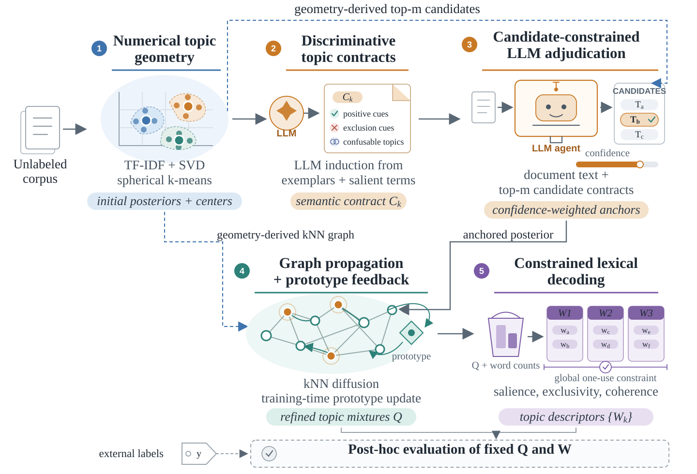
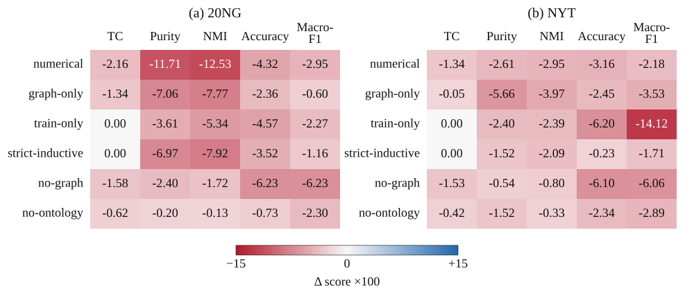
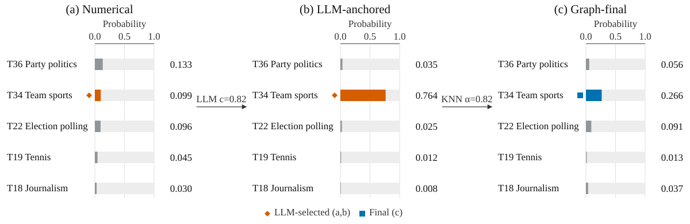

# CIPHER-TM

**Refining Probabilistic Topic Mixtures with Large Language Model Judgments for
Unsupervised Topic Modeling**

CIPHER-TM is an unsupervised topic-refinement framework that makes probabilistic topic
mixtures better reflect the thematic content of individual documents. Numerical topic
models recover corpus-level structure from lexical statistics, but shared entities and
surface similarity can make the most probable topic differ from a document's semantic
focus. A large language model (LLM) can resolve these distinctions, although its judgment
for one document is categorical and local rather than a corpus-level probability update.

CIPHER-TM bridges this gap by converting document-level LLM judgments into soft
probabilistic corrections and coordinating them across the corpus. No corpus labels are
used during topic induction or refinement; external labels are introduced only after the
topic mixtures and descriptors have been fixed for evaluation.

## Method

  

<em>A numerical topic model induces initial document-topic distributions and topic prototypes. The LLM supplies candidate-conditioned semantic judgments, which are converted into soft anchors and integrated across the corpus before mixture-based topic descriptors are decoded.</em>

The method has five stages:

1. **Numerical topic induction** produces initial document-topic mixtures and topic
   prototypes from the unlabeled corpus.
2. **Discriminative topic contracts** describe positive evidence, exclusion evidence, and
   confusable alternatives for each corpus-induced topic.
3. **Candidate-constrained adjudication** asks the LLM to distinguish among a document's
   most relevant topics and combines its choice and confidence with the numerical mixture
   as a soft anchor.
4. **Corpus-level integration** propagates these corrections over a document graph and
   incorporates the aggregated evidence into the shared topic prototypes.
5. **Constrained lexical decoding** derives topic descriptors from the refined mixtures
   using salience, exclusivity, coherence, and global word allocation.

The resulting representation preserves soft topic membership while allowing local semantic
judgments to improve corpus-level topic probabilities.

## Main results

CIPHER-TM is evaluated on 20 Newsgroups (20NG) and a fixed 12-category split derived from
the New York Times Annotated Corpus (NYT). The reported metrics cover topic descriptor
quality (TC and TD), agreement with held-out document categories (purity and NMI), and the
predictive utility of frozen topic mixtures (accuracy and macro-F1). The table reports the
paper's full-inference setting, which applies LLM adjudication to all training and target
documents and propagates target mixtures over the target collection.

| Dataset | TC | TD | Purity | NMI | Accuracy | Macro-F1 |
| --- | ---: | ---: | ---: | ---: | ---: | ---: |
| 20NG | **0.6903** | **1.0000** | **0.6676** | **0.5844** | **0.6938** | **0.6783** |
| NYT | **0.7862** | **1.0000** | **0.6950** | **0.3872** | **0.7832** | **0.6050** |

CIPHER-TM achieves the best result on every reported comparison metric on both corpora.
Relative to the strongest baseline for each metric, TC improves by **7.55%** on 20NG and
**14.25%** on NYT; macro-F1 on NYT improves by **4.84%**.

## Ablations and parameter sensitivity

  

<em>Ablation effects relative to the full method. Each cell reports 100 multiplied by the difference between a variant and the full score within one dataset.</em>

The full method is higher than the numerical and no-graph variants on every varying metric
for both corpora. The complete component ablations further show that document-level semantic
judgment, corpus-level propagation, topic contracts, and prototype feedback contribute
complementary information rather than interchangeable gains.

Parameter sweeps use a shared reference configuration without implying that one setting
optimizes every objective. An anchor weight of 0.90 is the strongest tested setting on all
five varying metrics in both corpora. Increasing the LLM judgment budget most clearly
improves assignment and predictive metrics, while graph neighborhood and propagation weight
exhibit corpus-dependent tradeoffs.

## Qualitative example

  

<em>Three-stage inference for NYT document 59. Numerical inference ranks European party politics first and team sports second; candidate-conditioned adjudication selects team sports with confidence 0.82, and propagation retains it as the final topic.</em>

The numerical mixture assigns probability 0.133 to a general Spain and European politics
topic and 0.099 to team sports, despite the article focusing on the election of FC
Barcelona's president. The LLM judgment raises the team sports probability to 0.764 and
reverses the ranking. Graph propagation then moderates it to 0.266 while preserving team
sports as the final topic, combining local semantic correction with corpus-level evidence.

## Citation

Citation metadata will be added when the paper is publicly available. Until then, please
refer to this repository and the paper title given above.

## License

The source code is released under the [Apache License 2.0](LICENSE).
